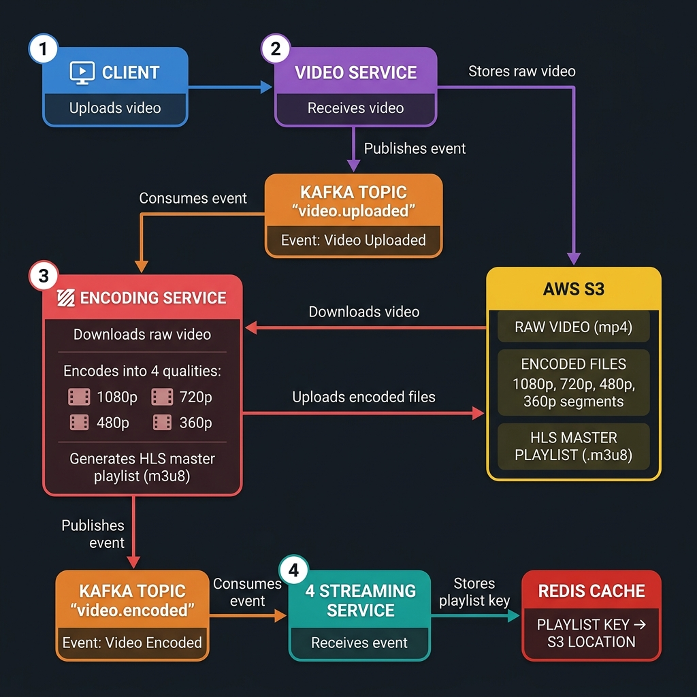
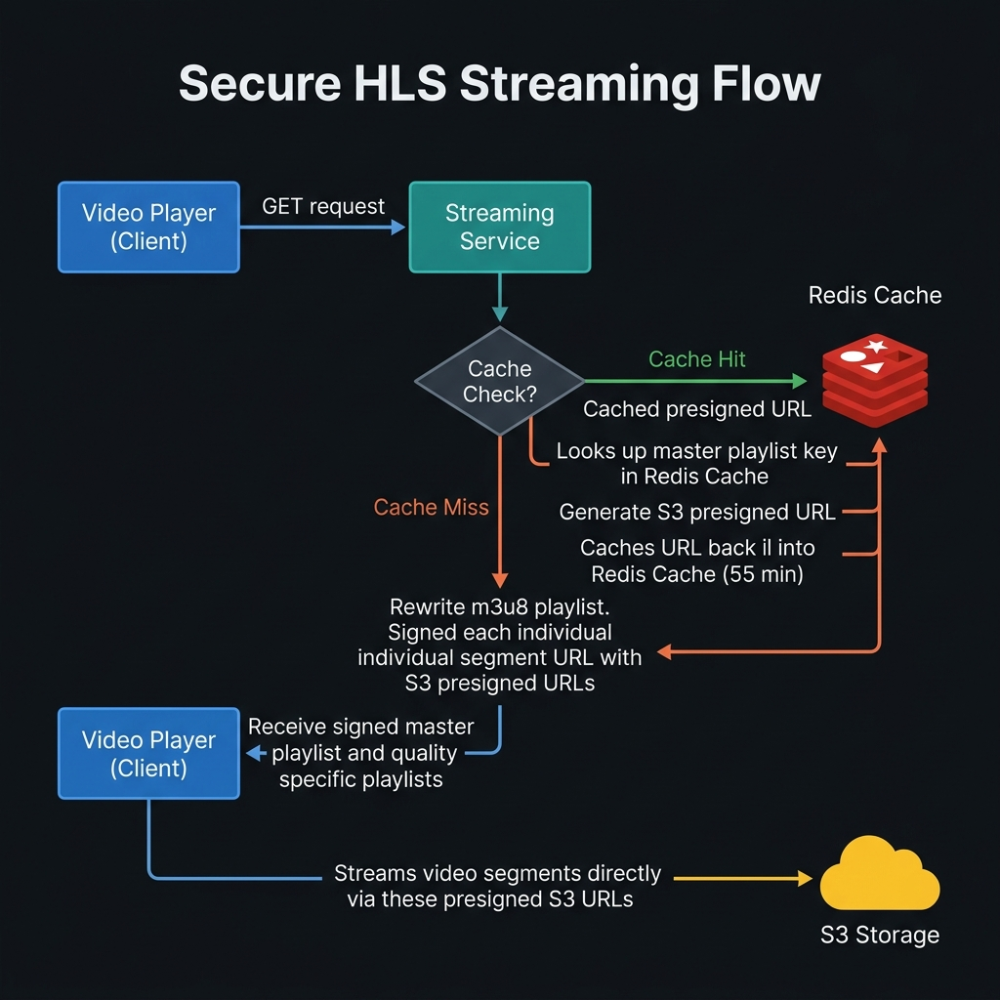

<div align="center">

# Zetflix

**A Netflix-style video streaming platform built on event-driven microservices**

[](https://openjdk.org/)
[](https://spring.io/projects/spring-boot)
[](https://react.dev/)
[](https://kafka.apache.org/)
[](https://www.docker.com/)
[](https://aws.amazon.com/)
[](https://github.com/features/actions)

[](LICENSE)
[](CONTRIBUTING.md)
[](../../issues)

[Overview](#overview) •
[Architecture](#architecture) •
[Tech Stack](#tech-stack) •
[Getting Started](#getting-started) •
[Deployment](#deployment) •
[Contributing](#contributing)

</div>

---

## Overview

Zetflix is a full-stack, event-driven video streaming platform that mirrors the core architecture patterns used by real production streaming services — independent microservices communicating asynchronously to handle authentication, media ingestion, transcoding, and playback delivery.

It was built as a hands-on systems engineering project to explore microservice decomposition, event-driven communication, video pipeline design, and production-style DevOps (Docker, CI/CD, cloud deployment) in a single cohesive application.

### Features

- Secure authentication with email OTP verification
- Video upload pipeline with background transcoding to HLS (multiple quality renditions)
- Fast content delivery via Redis-cached S3 presigned URLs
- Event-driven communication between services using Apache Kafka
- Watch history tracking per user
- Fully containerized — one command spins up the entire stack locally
- Automated CI/CD — push to `main` builds, tests, and deploys automatically

---

## Architecture

### System Architecture

<p align="center">
  
</p>

Zetflix is split into four independently deployable Spring Boot services, a Kafka event backbone, and a React frontend:

| Service | Responsibility | Port |
|---|---|---|
| **Content Service** | Authentication, OTP email verification, movie catalog, watch history | `8081` |
| **Video Service** | Handles video uploads, stores raw files in S3, emits upload events | `8082` |
| **Encoding Service** | Consumes upload events, transcodes video to HLS via FFmpeg, uploads renditions to S3 | `8083` |
| **Streaming Service** | Generates presigned S3 URLs for playback, cached in Redis for low-latency delivery | `8084` |

Services never call each other directly for state-changing operations — they communicate through Kafka topics, keeping each service independently deployable and resilient to partial failures.

### Encoding Pipeline

<p align="center">
  
</p>

### Streaming Flow

<p align="center">
  
</p>

### AWS Deployment & CI/CD

<p align="center">
  
</p>

Every push to `main` triggers an automated pipeline:

1. GitHub Actions builds and tests each service in parallel
2. Docker images are built and pushed to Amazon ECR
3. The workflow connects into a single EC2 instance over SSH
4. The EC2 instance (via an attached IAM role — no static keys on the box) authenticates to ECR and pulls the latest images
5. `docker-compose` restarts the stack with zero manual intervention

This intentionally uses a single EC2 host with Docker Compose rather than Kubernetes/EKS — a deliberate cost/complexity tradeoff for a project run intermittently rather than serving continuous traffic at hyperscale.

---

## Tech Stack

<table>
<tr>
<td valign="top" width="33%">

**Backend**
- Java 21 / Spring Boot
- Spring Security (JWT)
- Spring Data JPA
- Spring Kafka

</td>
<td valign="top" width="33%">

**Data & Messaging**
- MySQL 8
- Redis 7
- Apache Kafka + Zookeeper
- Amazon S3

</td>
<td valign="top" width="33%">

**Frontend & Infra**
- React + Vite
- Docker & Docker Compose
- GitHub Actions
- AWS EC2 / ECR / IAM

</td>
</tr>
</table>

---

## Getting Started

### Prerequisites

- Docker & Docker Compose
- Java 21 (for local development outside containers)
- Node.js 20 (for frontend development)
- An AWS account with an S3 bucket (for video storage)
- A Gmail account with an [App Password](https://myaccount.google.com/apppasswords) (for OTP emails)

### Local Setup

```bash
# Clone the repository
git clone https://github.com/nareshAiNexus/Zetflix.git
cd Zetflix

# Create your environment file
cp .env.example .env
# Fill in: MYSQL_ROOT_PASSWORD, MAIL_USERNAME, MAIL_APP_PASSWORD, AWS credentials, S3 bucket name

# Start the full stack
docker compose up --build
```

Once all containers report healthy:

| Endpoint | URL |
|---|---|
| Frontend | http://localhost |
| Content Service | http://localhost:8081 |
| Video Service | http://localhost:8082 |
| Encoding Service | http://localhost:8083 |
| Streaming Service | http://localhost:8084 |

### Environment Variables

See [`.env.example`](.env.example) for the full list of required variables. Never commit a populated `.env` file — it's gitignored by default.

---

## Deployment

Zetflix deploys to a single AWS EC2 instance running Docker Compose, orchestrated via GitHub Actions. This is a deliberate choice: the project is exercised intermittently (demos, interviews) rather than as a 24/7 production service, which keeps costs low while still demonstrating genuine cloud deployment patterns.

Full deployment steps, security group configuration, and cost-saving practices (stop/start scheduling, Elastic IP management) are documented in [`docs/DEPLOYMENT.md`](docs/DEPLOYMENT.md).

---

## Roadmap

- [ ] Go-based rewrite of one or more services for performance benchmarking against the JVM implementation
- [ ] Horizontal scaling support for the streaming service
- [ ] Automated integration tests in the CI pipeline
- [ ] Optional migration path to EKS for production-scale deployment

---

## Contributing

Contributions are welcome. Please read [CONTRIBUTING.md](CONTRIBUTING.md) for guidelines on how to get started, coding conventions, and the pull request process.

---

## License

This project is licensed under the MIT License — see [LICENSE](LICENSE) for details.

---

<div align="center">

Built by [Naresh K](https://github.com/nareshAiNexus) · [LinkedIn](https://linkedin.com/in/naresh-aidev)

</div>
